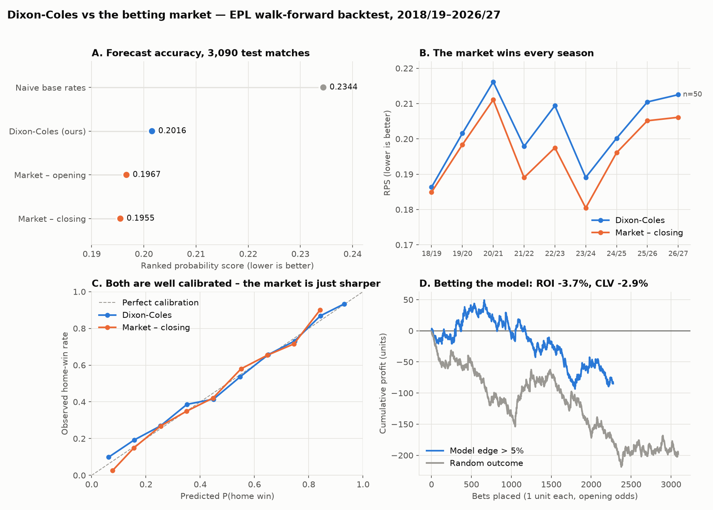

# EPL Match Forecasting: Dixon-Coles vs the Betting Market

A walk-forward backtest of the Dixon-Coles (1997) football model on 12+ seasons of
Premier League data, benchmarked against bookmaker opening and closing odds, with
closing-line value (CLV) analysis.



## Results (test period 2018/19 – 2026/27, 3,090 matches)

| Forecaster | RPS ↓ | Brier ↓ | Log-loss ↓ |
|---|---|---|---|
| Naive base rates | 0.2344 | 0.6472 | 1.0694 |
| **Dixon-Coles (this repo)** | **0.2016** | **0.5792** | **0.9804** |
| Market – opening (devigged) | 0.1967 | 0.5690 | 0.9600 |
| Market – closing (devigged) | 0.1955 | 0.5665 | 0.9564 |

Betting simulation (flat 1-unit stakes at opening odds, one bet per match when
the model's expected value exceeds the threshold):

| Edge threshold | Bets | ROI | 95% bootstrap CI | Mean CLV | Bets beating close |
|---|---|---|---|---|---|
| > 0% | 2,880 | −3.7% | −10.0% … +2.9% | −3.0% | 31% |
| > 5% | 2,276 | −3.7% | −10.7% … +3.7% | −2.9% | 33% |
| > 10% | 1,757 | −4.7% | −13.7% … +4.3% | −2.8% | 34% |

For reference, betting a **random** outcome on every match gives CLV −2.9%
(that is just the bookmaker's margin).

### What this shows

1. **The model learns real signal.** It cuts RPS by 14% versus naive base
   rates and is well calibrated.
2. **It does not beat the market.** The closing line is sharper in every
   single season.
3. **Its "edges" are noise.** Bets on the model's disagreements with the market
   have CLV indistinguishable from random bets. Blending the model into the
   opening odds was also tested: the optimal weight chosen on validation
   seasons was **0**, meaning the model adds no information the market doesn't
   already price.
4. **Profit and loss is the wrong yardstick.** Even across ~2,300 bets the ROI
   confidence interval spans roughly ±7%. CLV detects the absence of edge far
   faster than P&L does.

This is the expected result for a goals-only model and it establishes the
baseline any richer model (xG, Elo, lineups) has to beat.

## Verifiable track record

Backtests are easy to overfit, so the model also makes live forecasts whose
timing anyone can check. Before each round, a hash of the predictions is posted
on Solana **devnet** via the Memo program; after the round, the predictions are
revealed in [`predictions/revealed/`](predictions/revealed/) and scored. A
forecast cannot be edited after kickoff, and a bad week cannot be quietly
dropped.

Canonical signer: [`EKjxGc617c1YqVYGPGGNZutuLcHHnoEGR1Ku5iFjJSxo`](https://explorer.solana.com/address/EKjxGc617c1YqVYGPGGNZutuLcHHnoEGR1Ku5iFjJSxo?cluster=devnet)
(only memos from this address count).

**Weekly workflow** (`make setup` installs the Solana packages)

1. `make predict`: refresh data, fit on matches strictly before the round, write
   `predictions/pending/<round>/predictions.json`. Refuses if training data is
   incomplete against the football-data.org schedule.
2. `make commit`: before the first kickoff, post the commitment memo. Refuses
   after kickoff, on uncommitted code changes, or on any non-devnet RPC.
3. `make reveal`: from last kickoff + 3h, move the round to
   `predictions/revealed/<round>/` and commit it to git.
4. `make score`: score revealed rounds (RPS, Brier, log-loss for model vs open
   and closing market; CLV) into `predictions/track_record.csv`.

**The commitment.** `salt.hex` holds 32 random bytes, kept private until reveal
so the hash gives nothing away. The commitment is
`sha256(salt_bytes + predictions.json bytes)`, where `predictions.json` is
canonical JSON (sorted keys, fixed float format), so the bytes are reproducible.
The memo text is `premodel:v1:<round_id>:<commitment>`. `premodel-test:` memos
are dry runs and are ignored.

**Verify a round yourself.** Clone the repo, `pip install -e ".[onchain]"`, then:

```bash
python -m premodel verify --round E0-2026-10-17   # PASS, or FAIL: <reason>
```

This recomputes the hash from the revealed files and checks it against the
on-chain memo. It also checks that the signer is the canonical address, that
the block time is before the round's first kickoff, and that the signer posted
no other commitment for that round. Without the package, recompute the hash and
compare it with the memo shown on Explorer (the link is in the round's
`commit.json`):

```bash
d=predictions/revealed/E0-2026-10-17
python -c "import hashlib; print(hashlib.sha256(bytes.fromhex(open('$d/salt.hex').read().strip()) + open('$d/predictions.json','rb').read()).hexdigest())"
```

**Unrevealed rounds count against the record.** `python -m premodel audit`
lists every `premodel:v1` memo the canonical signer has ever posted. A round
committed but not revealed within 10 days of its date is flagged `overdue`, as
are mismatched or duplicate commitments, and audit exits non-zero. A missing
reveal should be read as a hidden bad forecast.

Caveats: this is devnet, not mainnet, so it proves timing and integrity rather
than economic stake. Block times are validator estimates (seconds of drift).

## Experiments

Analysis notes with decision rules set in advance (any deviation is disclosed in the note):

- [Shrinking low-sample team ratings](reports/experiments/shrinkage/README.md):
  removes extreme probabilities for promoted teams, but no detectable overall RPS gain.
- [Is the Championship market softer?](reports/experiments/championship/README.md):
  no. The same model's gap to the market is not smaller in the Championship
  (nominally larger), its bets do not beat random bets, and blending adds nothing.
- [A joint multi-league model](reports/experiments/joint/README.md): one rating per
  team across the top three divisions. Better in the Championship and for newly
  promoted or relegated teams; no detectable change in the Premier League; still no
  edge over the market.

## Method

- **Model**: home goals ~ Poisson(exp(γ + att_home + def_away)), away goals ~
  Poisson(exp(att_away + def_home)), with the Dixon-Coles ρ correction on the
  0-0 / 0-1 / 1-0 / 1-1 cells and exponential time-decay weights exp(−ξ·days).
  Fitted by weighted maximum likelihood (L-BFGS-B, analytic gradient,
  gradient-checked), small ridge penalty, sum-to-zero attack constraint.
- **Promoted teams** with no top-flight data get the mean ratings of the three
  weakest fitted teams.
- **Walk-forward**: refit before every match date on the previous 3 years of
  matches only. No future information is used.
- **Splits**: 2014/15 warm-up · 2015/16–2017/18 validation (choose ξ) ·
  2018/19–2026/27 test. Chosen ξ = 0.003/day (half-life ≈ 231 days).
- **Odds**: Pinnacle (the sharpest book) for opening and closing prices; the
  market average where Pinnacle is unavailable (later 2025/26 and 2026/27,
  220 test matches). Margins removed proportionally.
- **CLV** = opening odds × devigged closing probability − 1, i.e. the
  bet's expected value if the closing line is the truth.

## Project structure

```
Prem_prediction/
├── data/
│   ├── raw/                 # football-data.co.uk CSVs (git-ignored; `make data`)
│   └── processed/           # regenerated outputs, e.g. test_predictions.csv
├── notebooks/               # exploration
├── predictions/revealed/    # revealed rounds (pending/ stays private)
├── reports/
│   ├── summary.json         # every metric from the latest backtest
│   └── figures/             # charts used in this README
├── src/premodel/
│   ├── config.py            # paths, splits, decay grid, thresholds
│   ├── data.py              # download, load, de-vig
│   ├── metrics.py           # RPS, Brier, log-loss, calibration
│   ├── models/dixon_coles.py
│   ├── backtest.py          # walk-forward, betting sim, CLV
│   ├── plots.py
│   ├── forward.py           # weekly predictions for upcoming fixtures
│   ├── results.py           # football-data.org results fallback
│   ├── commitment.py        # canonical JSON, commitment, verify, audit
│   ├── onchain.py           # Solana devnet client (only module using solana)
│   ├── track_record.py      # reveal + score
│   └── __main__.py          # CLI: python -m premodel <command>
├── tests/                   # model, metrics, and no-leakage tests
├── Makefile
└── pyproject.toml
```

## Run it

```bash
python -m venv .venv && source .venv/bin/activate
make setup      # pip install -e ".[dev,onchain]"
make data       # download season CSVs into data/raw/
make all        # tune decay, walk-forward backtest, render charts (~30 s)
make test       # incl. checks that no fit ever sees future matches
```

Data: [football-data.co.uk](https://www.football-data.co.uk) Premier League
CSVs.

## Next steps

- [ ] Gradient-boosted model on Dixon-Coles ratings + xG (the 2026/27 files
      now include `HxG`/`AxG`), Elo and rest days; same walk-forward harness
- [x] Weekly forward pipeline logging predictions and CLV live
- [x] Commit-reveal of each week's predictions on Solana (Memo program) so the
      forward track record is verifiably pre-kickoff
