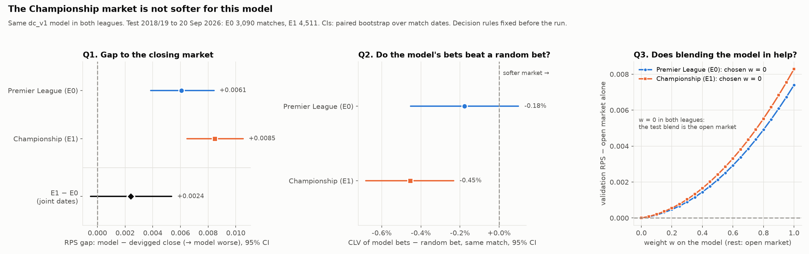

# Experiment: is the Championship betting market softer?

**TL;DR.** No. The same Dixon-Coles model (`dc_v1`) was run on the Championship
(E1) and on the Premier League (E0). It does not get closer to the market in the
Championship: its gap to the closing odds is, if anything, larger. Its bets do not
beat random bets, and blending it into the market's odds does not help. All three
decision rules were fixed before the run, and all three come out negative. Looking
beyond those rules, most of E1's extra gap comes from teams that are new to the
league. That points to the next model, not to a softer market.



## Hypothesis

Football folklore says lower-league markets are less efficient: less money, less
attention, more room for a model. The `dc_v1` model loses to the Premier League
market (published backtest RPS 0.2016 against 0.1955 for the closing odds). If the
Championship market is softer, the *same unmodified model* should do relatively
better there: a smaller gap to the market, bets that beat chance, or information
the market lacks. Only the market changes; the model is held fixed.

## Protocol

**The decision rules were fixed and approved before any Championship result was
computed.** They are written into `summary.json`.

- **Data.** football-data.co.uk Championship (E1) files for 2014/15 to 2026/27: 552
  matches per complete season, 24 teams, league matches only. The E0 code paths
  were generalised to take a league code. Re-running the published E0 backtest
  gives a byte-identical `reports/summary.json` (opt-in test: `pytest -m slow`).
- **Model.** `dc_v1`, unchanged, with the same walk-forward as the E0 backtest:
  refit before every match date on the previous three years, with promoted teams
  given the mean of the three weakest fitted teams. Time decay ξ is tuned on E1
  validation seasons (2015/16–2017/18) only, on the E0 grid.
- **Test window.** 2018/19 to 20 Sep 2026 in both leagues, the window of the
  published E0 backtest: **3,090 E0 and 4,511 E1 matches**. One E1 match has no
  opening odds and is left out of the comparisons that need them.
- **Odds.** Pinnacle where available, the market average otherwise (most of
  2025/26 and all of 2026/27 in both leagues), de-vigged proportionally.
- **Inference.** Every CI is a paired bootstrap that resamples whole match dates
  (5,000 resamples), because matches on one date share a model fit. Primary CIs
  are also reported at 98.3% (Bonferroni for three questions) as a robustness line.
  The decisions use 95%.

| | Question | Decision rule (fixed in advance) |
|---|---|---|
| Q1 | Is the model's gap to the closing market smaller in E1? | Gap = model RPS − de-vigged closing RPS, per match. "Smaller" if the 95% CI of gap(E1) − gap(E0) is below 0, resampling match dates jointly across leagues. |
| Q2 | Is the E1 market softer? | For each bet the model takes (edge > 0 at opening odds, the backtest rule): CLV of that bet minus the expected CLV of a random bet on the *same* match. "Softer" if the 95% CI is above 0. |
| Q3 | Does the model add information the E1 market lacks? | Blend w·model + (1−w)·de-vigged opening odds, with w chosen on validation. "Yes" if w > 0 and the 95% CI of test RPS (blend − open) is below 0. |

Comparing against a random bet *on the same match* (Q2) removes the bookmaker's
margin, which varies from match to match. What remains is whether the model picks
better outcomes than chance.

## Results: pre-registered decisions

| | Premier League (E0) | Championship (E1) | Decision |
|---|---|---|---|
| **Q1** RPS gap, model − close | +0.0061 (95% CI +0.0038, +0.0084) | +0.0085 (+0.0065, +0.0105) | E1 − E0 = **+0.0024 (−0.0005, +0.0054)**: **not smaller** |
| **Q2** CLV, model bet − random bet | −0.18% (−0.45%, +0.10%) | −0.45% (−0.68%, −0.23%) | **not softer** |
| **Q3** blend weight on validation | w = 0 | w = 0 | the blend is the market: **no added information** |

- **Q1.** The difference of gaps points the other way from the hypothesis, though
  its CI includes zero. Bootstrapping each league independently, as a sensitivity
  check, gives +0.0024 (−0.0007, +0.0056). The 98.3% intervals give the same
  decisions on all three questions.
- **Q3.** Validation RPS gets steadily worse as weight moves from the market to the
  model, in both leagues (figure, right panel).

## Observation, outside the decision rules

In E1 the Q2 interval is entirely *below* zero (−0.45%, CI −0.68% to −0.23%;
98.3% CI −0.72% to −0.18%). The outcomes the model chooses to back have worse
closing-line value than a random pick on the same match. In other words, where the
model disagrees with the Championship market, the closing line tends to move
*against* the model. The rules tested for a softer market, not for this, so it is
reported as an observation rather than a conclusion. It is consistent with the
secondary results: an ROI of −7.1% (95% CI −11.5% to −2.5%) at threshold 0, against
an opening margin of about 3.6%.

## Secondary results

| | E0 | E1 |
|---|---|---|
| RPS: model / open / close | 0.2016 / 0.1967 / 0.1955 | 0.2226 / 0.2147 / 0.2142 |
| Log-loss: model / close | 0.980 / 0.956 | 1.067 / 1.036 |
| Brier: model / close | 0.579 / 0.567 | 0.641 / 0.623 |
| Overround, open / close (all sources) | 3.2% / 2.9% | 3.6% / 3.3% |
| Overround, open / close (Pinnacle only) | 2.9% / 2.7% | 3.3% / 3.0% |
| ROI at threshold 0 (95% CI) | −3.7% (−10.2%, +3.1%) | −7.1% (−11.5%, −2.5%) |
| CLV of model bets / random bet, all matches | −3.00% / −2.88% | −3.85% / −3.48% |

- **Overall.** The Championship is harder to forecast for everyone (RPS about
  0.214 against 0.196 for the closing odds), and the margin is slightly higher. The
  model falls further behind there.
- **Per season.** The E1 gap is positive in every test season, from +0.004 to
  +0.014, plus +0.030 in the 95 matches of 2026/27. The E0 gap is positive in every
  season, from +0.001 to +0.012.
- **Calibration.** In E0 the model is well calibrated apart from the tails. In E1
  it is clearly overconfident at the extremes: its 84% home-win bin wins 56% of the
  time, and its 74% away-win bin 28%.

## Exploratory: where the extra gap comes from

*Not pre-registered. Hypothesis-generating only.*

Matches involving a team in its first 10 games after entering the league:

| | n | model RPS | close RPS | gap (95% CI) |
|---|---|---|---|---|
| E1: relegated from the PL | 247 | 0.2260 | 0.2008 | +0.0253 (+0.0093, +0.0421) |
| E1: promoted from League One | 215 | 0.2360 | 0.2105 | +0.0255 (+0.0102, +0.0413) |
| E1: all other matches | 4,049 | 0.2217 | 0.2151 | +0.0065 (+0.0047, +0.0084) |
| E0: promoted from the Championship | 240 | 0.1924 | 0.1806 | +0.0118 (−0.0040, +0.0281) |
| E0: all other matches | 2,850 | 0.2023 | 0.1967 | +0.0056 (+0.0035, +0.0077) |

Excluding newly arrived teams, the two leagues' gaps are close (+0.0065 against
+0.0056). Teams new to the Championship cost the model about four times as much
per match as everyone else, whichever direction they arrive from. Six teams enter
the Championship each season against three in the Premier League, so this error
weighs more there. This suggests, but does not show, that E1's extra gap is mostly a
model weakness with newly arrived teams rather than a sharper market. Testing that
needs a model that can handle them.

## Conclusion

On the three pre-registered questions, the Championship market is **not** softer for
this model. The gap to the closing market is not smaller (it is nominally larger),
the model's bets do not beat random bets, and the validation-chosen blend weight is
zero. The folklore claim is not supported here. A goals-only model does not get an
edge just by moving down a division.

## Limitations

- **E1 ξ at the grid edge.** Validation chose ξ = 0.005, the largest value on the
  E0 grid (RPS 0.21829 against 0.21833 at 0.003, so the curve is nearly flat). As
  fixed in advance, the grid was not extended. Because the curve is so flat
  between 0.003 and 0.005, a larger ξ seems unlikely to change much, but that was
  not tested.
- **Weaker benchmark in recent seasons.** The closing benchmark is the market
  average rather than Pinnacle for most of 2025/26 and all of 2026/27, which is
  8.4% of E1 test matches and 7.1% of E0.
- **The model cannot see outside the league.** A team relegated from the PL has no
  Championship history and gets the "three weakest teams" prior. Its PL record,
  squad and parachute payments are invisible. The exploratory section suggests this
  is costly.
- **One model.** These results are about `dc_v1`. A better model might find
  softness that this one cannot.
- **Several comparisons.** Three primary questions and many secondary numbers were
  reported. The decision rules and the 98.3% line guard the primary ones; the
  observation and the exploratory section are not confirmatory.

## Next steps

The largest error source we can identify, in both experiments, is teams new to a
league. In the Championship they cost about four times as much per match as
everyone else; in the Premier League the shrinkage experiment patched the same
weakness without a detectable overall gain. The proposed follow-up is a **joint
multi-league model**:

- one attack/defence rating per team across E0, E1 and E2 (League One), with a
  fitted strength offset for each league;
- a relegated or promoted team keeps its history, translated by the league offset,
  rather than starting from a generic prior;
- evaluated with the same walk-forward protocol, decision rules fixed in advance,
  in both E0 and E1, with the new-team subgroup as a pre-registered secondary
  outcome this time.

## Reproduce

```bash
python -m premodel download --league E1   # Championship CSVs into data/raw/
make experiment-championship              # ~20 s; writes summary.json and the figure here
pytest -m slow                            # E0 backtest still byte-identical
```

Code: `src/premodel/experiments/championship.py` and `championship_plot.py`. Tests:
`tests/test_championship.py` and `tests/test_leagues.py`.
