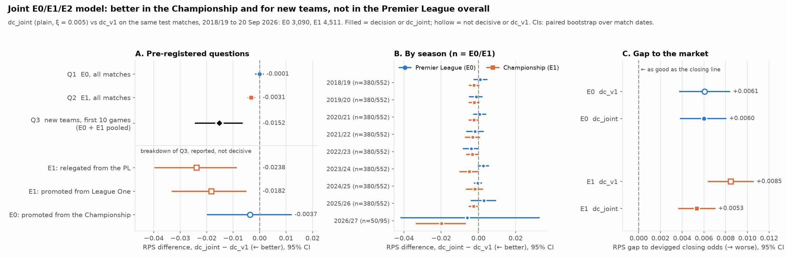

# Experiment: a joint multi-league model

**TL;DR.** The new model, `dc_joint`, fits one rating per team across the Premier
League (E0), Championship (E1) and League One (E2), so promoted and relegated teams
keep their history. Compared with the single-league baseline `dc_v1`:

- It improves Championship forecasts: RPS −0.0031 (95% CI −0.0044 to −0.0019).
- It improves the pre-registered new-team matches: −0.0152 (−0.0243 to −0.0065).
- It shows **no detectable change in Premier League forecasts**: −0.0001 (−0.0016
  to +0.0014).
- It **still has no edge over the betting market**: in both leagues its bets have
  closing-line value no better than random bets.

All three decision rules were fixed before the run. No rule for adopting the model
was pre-registered; adoption is a separate decision (see "Adoption considerations").



## Motivation

The two previous experiments found the same weak spot. Teams new to a league are the
largest error source we can identify. In the Championship, their first 10 games had an
RPS gap to the market about four times that of other matches. In the Premier League,
the shrinkage experiment patched the same weakness with a prior, without a detectable
overall gain. A team relegated from the Premier League arrives in `dc_v1`'s Championship
model with no history at all, and gets the "three weakest teams" prior. A joint model
lets that team carry its real record across the boundary.

## The model

For a match in league L:

`log λ_home = γ_L + b_L + att_home + dfn_away`, and
`log μ_away = b_L + att_away + dfn_home`

with one `(att, dfn)` per team shared across all three leagues. Everything else is as
in `dc_v1`: the low-score correction, time decay, 3-year lookback, ridge, and a soft
sum-to-zero on attack (here over all teams in all leagues).

- **How the leagues are linked.** Leagues never play each other, so they are linked
  only through teams that move between them. A promoted team's matches in both leagues
  inform one rating, which puts both leagues' teams on one scale. A league's strength
  is simply where its teams sit on that scale; a separate per-league rating offset is
  not identifiable on top of that.
- **Per-league terms.** `γ_L` (home advantage) is identified within each league.
  `b_L` (goal environment) is identified only through movers, with E0 as the
  reference (`b_E0 = 0`).
- **Disconnected leagues.** If no mover links two leagues in a training window, a
  team's rating is not used across them; the per-league fallback (mean of the three
  weakest teams) applies instead. Every one of the 1,394 test fits was connected,
  through 17–25 multi-league teams. Only 2 early validation fits were not.
- **One league only.** With E0 data alone, `dc_joint` has exactly `dc_v1`'s
  parameters, objective and starting point. It reproduces `dc_v1` to about 1e-11 in
  parameters (tested).

### Identification of the "move shift" variant

The optional variant adds a rating shift for a team's first season after moving
league, pooled by direction. The planning assumption was that free up and down shifts
are never identified, because a common shift in league gaps can be traded against
them. **The Hessian analysis corrected this.**

- **Where the assumption holds.** When every cross-league link runs through a team's
  *first* season after a move, the free shifts are exactly unidentified: two zero
  eigenvalues, for example at 12 Sep 2015.
- **Where it doesn't.** Once teams are in their second season or later after a move,
  they have unshifted matches in two leagues. Those link the leagues directly, and the
  free shifts become identified. They are imprecise, though: standard errors of about
  0.1–0.4, and unchanged between ridge 1e-3 and 1e-7.
- **What was done.** The down shift was fixed at 0, so the variant is identified in
  every window. Where the down shift *would* be identifiable, this is an assumption
  ("relegated teams don't change in their first season"), not just a normalisation.
- **What is not interpreted.** Neither the shifts nor the cross-league gaps (`b_L`,
  league positions on the shared scale) are read as substantive findings.

## Protocol

**Rules fixed before any result was computed, recorded in code and `summary.json`.**

- **Data.** football-data.co.uk E0, E1 and E2, seasons 2014/15 to 2026/27. E2 is
  training data only. Its 2019/20 season was cut short by COVID (400 matches, 23
  teams). Adding E2 leaves E0 and E1 unchanged (tested, including a byte-identical E0
  backtest).
- **Walk-forward.** Refit before every date with an E0 or E1 match to predict, on all
  three leagues' matches strictly before that date (no leakage, tested).
- **Selection.** Variant (plain or move shift) and ξ ∈ {0.001, 0.0019, 0.003, 0.005,
  0.007, 0.01} chosen by the **mean of the E0 and E1 validation RPS**, with equal
  weight per league, on 2015/16–2017/18. Chosen: **plain, ξ = 0.005**, an interior
  point, with validation RPS E0 0.1967 and E1 0.2167. The move-shift variant came
  second at the same ξ (mean 0.20680 against 0.20671).
- **Baselines.** `dc_v1` at its own ξ, first checked to reproduce E0 RPS 0.2016 on
  3,090 matches and E1 RPS 0.2226 on 4,511.
- **Test.** 2018/19 to 20 Sep 2026. Each CI is a paired bootstrap resampling whole
  match dates (5,000 resamples); 95% decides, and a 98.3% Bonferroni line is reported
  for robustness.

| | Question | Rule |
|---|---|---|
| Q1 | Does `dc_joint` beat `dc_v1` in E0? | 95% CI of per-match RPS(`dc_joint`) − RPS(`dc_v1`) entirely below 0 |
| Q2 | … in E1? | same |
| Q3 | … in matches with a team in its first 10 games after entering E0 or E1? | same, both leagues pooled |

## Results: pre-registered decisions

| | n | `dc_v1` RPS | `dc_joint` RPS | Difference (95% CI) | Decision |
|---|---|---|---|---|---|
| **Q1** E0 | 3,090 | 0.2016 | 0.2015 | −0.0001 (−0.0016, +0.0014) | no detectable improvement |
| **Q2** E1 | 4,511 | 0.2226 | 0.2195 | **−0.0031 (−0.0044, −0.0019)** | **improves** |
| **Q3** new teams, pooled | 702 | | | **−0.0152 (−0.0243, −0.0065)** | **improves** |

The 98.3% intervals give the same three decisions.

The Q3 breakdown by league and direction of entry was **reported but not part of any
decision rule**:

| Group | n | `dc_v1` | `dc_joint` | Difference (95% CI) |
|---|---|---|---|---|
| E1: relegated from the PL | 247 | 0.2260 | 0.2022 | −0.0238 (−0.0396, −0.0088) |
| E1: promoted from League One | 215 | 0.2360 | 0.2178 | −0.0182 (−0.0330, −0.0052) |
| E0: promoted from the Championship | 240 | 0.1924 | 0.1888 | −0.0037 (−0.0197, +0.0121) |
| E1: all other matches | 4,049 | 0.2217 | 0.2206 | −0.0011 (−0.0017, −0.0005) |
| E0: all other matches | 2,850 | 0.2023 | 0.2026 | +0.0002 (−0.0007, +0.0012) |

### Why a large new-team gain barely moves the Premier League

Only three teams enter the Premier League each season, all from below, so their first
10 games are **7.8% of E0 test matches**. The E0 new-team improvement (−0.0037)
contributes about −0.0003 to the overall average. Even a gain as large as the
Championship's (about −0.021) would contribute only about −0.0016, roughly the
half-width of the E0 confidence interval. The Championship has six entrants a season,
from both directions (10.2% of matches), and its other matches improve slightly too.
Together these make up its −0.0031.

## Secondary results

| | E0 `dc_v1` | E0 `dc_joint` | E1 `dc_v1` | E1 `dc_joint` |
|---|---|---|---|---|
| Log-loss | 0.9804 | 0.9756 | 1.0664 | 1.0517 |
| Brier | 0.5792 | 0.5796 | 0.6411 | 0.6339 |
| RPS gap to closing market (95% CI) | +0.0061 (+0.0038, +0.0084) | +0.0060 (+0.0039, +0.0080) | +0.0085 (+0.0064, +0.0105) | +0.0053 (+0.0037, +0.0070) |
| CLV of model bets − random bet (95% CI) | −0.18% (−0.46%, +0.09%) | −0.10% (−0.39%, +0.17%) | −0.45% (−0.68%, −0.22%) | −0.30% (−0.54%, −0.06%) |

- **Log-loss differences** (`dc_joint` − `dc_v1`): E1 −0.0147 (−0.0212, −0.0090);
  E0 −0.0048 (−0.0141, +0.0032).
- **Still no edge over the market.** `dc_joint` closes about 38% of the Championship
  gap to the closing line, but its bets are still no better than random in either
  league; in E1 they remain significantly worse.
- **Blend with the opening odds.** The validation-chosen weight is 0 in E1. In E0 it
  is 0.05, the first non-zero weight in any of these experiments, but on test the
  blend is indistinguishable from the market alone (+0.0000, CI ±0.0001).
- **Calibration.** `dc_v1`'s badly overconfident Championship extremes disappear (its
  0.84 home-win bin won 56% of the time); `dc_joint`'s bins sit close to the diagonal.
  E0 calibration barely changes.
- **Per season.** E1 improves in all nine test seasons, five with a CI below zero. E0
  seasons go both ways; only 2022/23 is significant.
- **Non-selected variant** (move shift, ξ = 0.005), secondary: almost identical. E0
  +0.0002, E1 −0.0030, Q3 −0.0150.

## Adoption considerations

**No adoption rule was pre-registered.** This section lays out the evidence; it does
not decide.

- **Premier League (the live pipeline).** There is no detectable improvement. The CI
  (−0.0016, +0.0014) puts any deterioration at no more than about 0.0014 RPS, about
  0.7% of the RPS and a quarter of the model's gap to the market. No margin for
  "non-inferior" was set in advance, so this is evidence, not a formal non-inferiority
  result.
- **New teams and the Championship.** Clear gains on the pre-registered new-team
  question and in E1, with better calibration at the extremes.
- **The live case.** For Coventry v Newcastle (12 Oct 2026), `dc_v1` committed home /
  draw / away 0.051 / 0.231 / 0.719. `dc_joint`, refitted on the same 1,119 E0 matches
  plus Coventry's 2025/26 Championship season, gives **0.314 / 0.275 / 0.410**. The
  devigged opening market was 0.288 / 0.262 / 0.450. This is one match, not evidence
  of accuracy, but it is exactly the failure the model targets.
- **Operational cost.** The weekly pipeline would need current E1 and E2 results as
  well as E0.
  - **Championship:** covered by this project's football-data.org key. The
    Championship (`ELC`) is on its plan, and a request on 12 Oct 2026 returned
    finished matches up to 11 Oct.
  - **League One:** not covered. It isn't among the competitions the key can access,
    and requests return 403 ("not within your permissions"). Current League One results
    would need a paid plan or the football-data.co.uk CSV, which lags by a few days.
    League One matters only indirectly for E0 forecasts, through teams moving between
    E1 and E2, so a short lag there costs little.
  - **Other work:** a team-name mapping for the 24 current Championship clubs, plus
    newcomers as teams move (currently only Premier League names are mapped); extending the completeness check to the
    Championship; fits about four times larger (about 4,400 matches); and a
    `model_version` bump.
- **No market edge.** Neither model has one, so adoption would be about forecast
  quality and the verifiable track record, not betting.

## Limitations

- **The cross-league scale rests on movers.** About 3 teams per direction per
  boundary per season, which is enough for these tests to be connected and
  identified, but `b_L` and league positions are noisier than ratings within a league.
- **Assumptions inside the model.** One decay rate for all leagues, one low-score
  correction (ρ) shared across leagues, and a team's rating assumed constant across a
  move apart from time decay.
- **The move-shift variant.** Its down shift is fixed at 0, which is an assumption
  where it would be identifiable (see above).
- **Early validation.** In the first weeks of 2015/16 nobody has moved yet within the
  data (2 disconnected fits).
- **Goals only.** No transfers, finances, xG or lineups.
- **Many comparisons.** Three primary questions plus many secondary ones. The decision
  rules and the 98.3% line guard the primary ones only.

## Next steps

- **If adopted:** run it in the weekly pipeline in parallel with `dc_v1` (both
  committed) for a season before switching, so the live record compares them on the
  same matches.
- **Model:** let ratings carry information across the summer (for example, regress
  toward a prior that depends on last season's league) instead of only decaying, and
  test whether separate low-score corrections per league help.
- **Data:** add xG, available in the 2026/27 E0 files, as in roadmap item 2.

## Reproduce

```bash
python -m premodel download --league E1 && python -m premodel download --league E2
make experiment-joint        # ~4 min; writes summary.json and joint.png here
pytest -m slow               # E0 backtest still byte-identical
```

Code: `src/premodel/models/dixon_coles_joint.py`, `src/premodel/experiments/joint.py`,
`joint_plot.py`. Tests: `tests/test_joint.py`.
