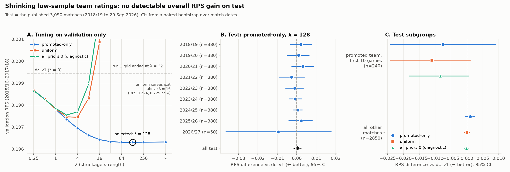

# Experiment: shrinking low-sample team ratings

**TL;DR.** Shrinking team ratings toward a prior removes the model's most extreme
probabilities. The live Coventry home-win forecast goes from 5% to 17–22%, against
a market price of 29%. But the pre-registered selection, made on validation seasons
only, picked a variant that gives **no detectable change in out-of-sample RPS**:
+0.0004 (95% CI −0.0015 to +0.0022) on 3,090 test matches. This note does not
recommend adopting it. The forward pipeline is unchanged.



## Problem and hypothesis

Dixon-Coles (`dc_v1`) fits an attack and a defence rating for each team by weighted
maximum likelihood. A team with only a few matches in the training window gets an
extreme estimate, because the ridge penalty (1e-3) carries almost no weight. The
promoted-team fallback only applies to teams with *zero* matches. In the live
forecast for Coventry v Newcastle on 12 October 2026, committed on-chain before
kickoff, Coventry had scored once in five games. Their attack rating was −1.56, and
the model gave them a 5.1% chance of winning at home. The market said about 29%.

*Hypothesis:* shrinking each team's ratings toward a sensible prior mean improves
out-of-sample RPS, mainly in early-season matches involving promoted teams, without
hurting other matches.

## Method

- **Penalty.** The fit adds `λ · Σ_i [(att_i − m_att_i)² + (dfn_i − m_dfn_i)²]` to the
  weighted negative log-likelihood, with an analytic gradient (checked numerically
  in the tests). One full-weight match carries about 1.3 units of information about
  a team's attack, so λ ≈ 1.3k acts like k pseudo-matches at the prior. That is
  strong for a team with 5 matches and negligible for one with 60. λ = ∞ fixes the
  penalised ratings at the prior. λ = 0 reproduces `dc_v1` exactly (tested).
- **Variants.** *Uniform:* every team is penalised. Promoted teams are pulled toward
  the promoted-team prior and everyone else toward 0 (league average).
  *Promoted-only:* only teams in their first season after promotion are penalised.
  *All priors 0:* uniform with every prior at 0. This is a diagnostic, never selected.
- **Promoted-team prior, without leakage.** A team counts as promoted in season S if
  it has played in S before the fit date and did not play in S−1. Relegated teams are
  the bottom 3 of S−1's points table, computed from S−1's results; this matches the
  real relegated teams in all 12 completed seasons. The prior for S is the running
  mean, over seasons up to S, of the relegated teams' ratings, each taken from a fit
  on matches strictly before that season began. So it is available from the first
  validation season, and it uses only full-season (38-match) ratings. For 2026/27
  the prior is attack −0.30, defence +0.35. Tests confirm that changing every result
  on or after the fit date leaves the labels and the prior unchanged.
- **Protocol.** Same walk-forward as the published backtest: refit before every match
  date on the previous 3 years, ξ = 0.003 fixed. λ and the variant are chosen by
  **validation RPS only** (2015/16–2017/18). The primary test set is exactly the
  **3,090 matches** in the published `reports/summary.json` (2018/19 to 20 Sep 2026).
  Before anything else, the harness checks that `dc_v1` reproduces the published
  RPS 0.2016, Brier 0.5792 and log-loss 0.9804; all match exactly. Differences are
  per match (variant − `dc_v1`), with 95% CIs from a **paired bootstrap that
  resamples whole match dates** (958 dates, 5,000 resamples), because matches on
  the same date share a fit. RPS is the primary metric; log-loss is secondary.

### Protocol deviation (disclosed)

Run 1 used λ ∈ {0.25 … 32} and selected promoted-only at λ = 32, the edge of the
grid, where the validation curve was still falling. **Run 1's test numbers were seen
before the grid was extended** (see the appendix). Because the optimum sat on the
boundary, the grid was extended on validation only, to 64, 128, 256 and ∞, for both
variants. This rule was fixed *before* run 2: the lowest validation RPS across both
variants and the full grid is the reported model, its test results are reported
whatever they are, and nothing further changes. Run 2 is the result reported below.

## Results

**Validation** (`dc_v1` RPS 0.19945)

| Variant | best λ | validation RPS |
|---|---|---|
| Uniform | 4 | 0.19744 |
| **Promoted-only (selected)** | **128** | **0.19630** |
| All priors 0 (diagnostic) | 2 | 0.19755 |

The promoted-only curve is flat from λ = 32 to ∞ (0.19633 → 0.19630 → 0.19632). In
other words, validation prefers treating promoted teams as typical relegated sides
all season. The uniform curves rise steeply above λ = 4, because shrinking every
established team hurts.

**Test, published 3,090 matches: selected model vs `dc_v1`** (lower is better)

| | RPS | Brier | log-loss |
|---|---|---|---|
| `dc_v1` | 0.2016 | 0.5792 | 0.9804 |
| **Promoted-only, λ = 128** | **0.2020** | 0.5805 | 0.9771 |
| Market closing (reference) | 0.1955 | | |

| Paired difference (variant − `dc_v1`) | mean | 95% CI |
|---|---|---|
| **RPS (primary)** | **+0.00039** | **−0.00151 to +0.00224** |
| log-loss (secondary) | −0.0033 | −0.0128 to +0.0053 |

| Subgroup | n | RPS `dc_v1` | RPS variant | RPS difference, 95% CI | log-loss difference, 95% CI |
|---|---|---|---|---|---|
| Promoted team, first 10 games | 240 | 0.1924 | 0.1850 | −0.0075 (−0.0241, +0.0091) | −0.074 (−0.182, +0.019) |
| All other matches | 2,850 | 0.2023 | 0.2034 | +0.0011 (−0.0003, +0.0024) | +0.0027 (−0.0020, +0.0073) |

- **Per season:** the differences have mixed signs, and no season's CI excludes zero
  (figure, panel B).
- **CLV** (backtest betting rule, threshold 0): −2.68% for the variant against
  −3.00% for `dc_v1`. Betting a random outcome gives −2.89%, so neither shows an edge.
- **Calibration:** the lowest home-win bin moves from 0.06 predicted / 0.10 observed
  (`dc_v1`) to 0.07 / 0.09. Nothing else changes materially.
- **Extended test set:** the season CSV has no matches after 20 Sep 2026 yet, so it
  equals the published set.

**Secondary: the non-selected variant and the diagnostic**, labelled as such and not
used for any choice

| | λ | RPS difference, 95% CI | log-loss difference, 95% CI | promoted, first 10: RPS difference |
|---|---|---|---|---|
| Uniform (not selected) | 4 | −0.00089 (−0.00221, +0.00037) | −0.0075 (−0.0158, −0.0002) | −0.0110 (−0.0241, +0.0011) |
| All priors 0 (diagnostic) | 2 | −0.00077 (−0.00169, +0.00011) | −0.0071 (−0.0147, −0.0007) | −0.0084 (−0.0181, +0.0006) |

Uniform and all-priors-0 behave almost identically. Most of whatever they gain comes
from generic shrinkage, not from the promoted-team prior. Their log-loss CIs just
exclude zero, but these are secondary metrics on non-selected models among several
comparisons, so they are a lead for future work, not a finding.

**Live case: Coventry v Newcastle, 12 Oct 2026.** Each model is refitted on the same
1,119 matches as the committed forecast; `dc_v1` reproduces the committed numbers.

| Model | Home / draw / away | Coventry attack |
|---|---|---|
| `dc_v1` (committed) | 0.051 / 0.231 / 0.719 | −1.56 |
| Promoted-only, λ = 128 | 0.217 / 0.259 / 0.524 | −0.31 |
| Uniform, λ = 4 | 0.168 / 0.264 / 0.568 | −0.59 |
| All priors 0, λ = 2 | 0.196 / 0.289 / 0.515 | −0.56 |
| Market open, devigged (average of bookmakers) | 0.288 / 0.262 / 0.450 | |

## Conclusion

1. **Shrinkage removes extreme probabilities.** Every variant pulls Coventry's
   attack from −1.56 to between −0.31 and −0.59, and the home-win probability from
   5% to 17–22%, much closer to the market's 29%. Matches involving a promoted team
   in its first 10 games improve by 0.0075–0.0110 RPS and 0.074–0.088 log-loss
   (point estimates). Overall log-loss improves for every variant.
2. **There is no statistically detectable overall RPS gain.** The pre-registered,
   validation-selected model (promoted-only, λ = 128) changes test RPS by +0.0004,
   with a CI from −0.0015 to +0.0022. It is slightly worse on non-promoted matches,
   and Brier is also slightly worse. The improvement is real but confined to
   about 8% of matches, which is too few to move the average beyond noise.

On this evidence the selected model should not replace `dc_v1`: it fails the primary
criterion. The forward pipeline is unchanged; any adoption decision, which would
bump `model_version`, is a separate choice.

## Limitations

- **Small validation sample.** Validation has three seasons and nine promoted teams,
  so selection among variants is noisy. Promoted-only won validation but did worse
  on test than uniform.
- **One λ for the whole season.** At λ = 128 a promoted team's ratings stay close to
  the prior for the entire season, largely ignoring its own form. A penalty that
  fades with games played was not tested. The likely reason non-promoted matches got
  worse is that misfit from pinning promoted teams is absorbed by their opponents'
  ratings.
- **"Promoted ≈ relegated" is an assumption.** The prior uses relegated teams'
  ratings. Its defence component has drifted up since 2024/25 (+0.29 → +0.35) as
  recent relegated sides conceded more.
- **The zero-match fallback is unchanged.** It is still the mean of the 3 weakest
  fitted teams, so that λ = 0 reproduces `dc_v1` exactly. Switching it to the
  promoted-team prior is a separate follow-up experiment.
- **Fixed settings.** ξ is fixed at 0.003 and was not retuned jointly with λ. The
  model still uses goals only (no xG, lineups or Elo).
- **The test numbers were seen once before the final grid** (see the protocol
  deviation above).

## Reproduce

```bash
make experiment-shrinkage   # ~1 min; writes summary.json and shrinkage.png here
```

Code: `src/premodel/experiments/shrinkage.py` and `shrinkage_plot.py`. Model variant:
`dixon_coles.fit(..., shrink=Shrinkage(...))`. Tests: `tests/test_shrinkage.py`.

## Appendix: run 1 (grid 0.25–32), superseded

Kept for transparency; full output in `run1_summary.json`. Selected promoted-only
at λ = 32, the grid boundary.

| Test, 3,090 matches | λ | RPS | RPS difference vs `dc_v1`, 95% CI | promoted, first 10 | all other |
|---|---|---|---|---|---|
| Promoted-only (selected in run 1) | 32 | 0.2014 | −0.00020 (−0.00191, +0.00139) | −0.0086 (−0.0246, +0.0071) | +0.0005 (−0.0006, +0.0017) |
| Uniform | 4 | 0.2007 | −0.00089 (−0.00222, +0.00033) | −0.0110 (−0.0241, +0.0012) | −0.0000 (−0.0009, +0.0008) |
| All priors 0 (diagnostic) | 2 | 0.2008 | −0.00077 (−0.00169, +0.00009) | −0.0084 (−0.0184, +0.0005) | −0.0001 (−0.0007, +0.0004) |

Run 1 had no log-loss bootstrap; that was added for run 2.
